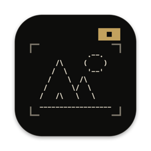

# Photo Picker

I was too lazy to find and download an app for this, so I made my own.

> this build was done under 30 min dont expect anything more from it and i prob wont update it

Photo Picker is a small native Mac app for going through a camera card fast. Plug in the card, flip through with the arrow keys, and press **Space** on the shots you want. Each pick is copied into a folder. It never changes anything on the card.

## What it does

The look is text-mode: SF Mono, tarnished cream on black, `[KEY]` buttons and box-drawing lines. That's only the chrome. Your photos and thumbnails are always shown as real images.

- **Opens your card by itself.** Insert an SD card or connect your camera and it loads every photo in the order you shot them. You can also open any folder with ⌘O or by dropping it on the window.
- **RAW + JPEG pairs count as one photo.** Picking `DSCF1141` copies both `DSCF1141.RAF` and `DSCF1141.JPG`, or only one of them if you choose that in Settings.
- **Filmstrip** of every shot, with picked ones marked. Click a thumbnail to jump to it.
- **Card map:** one line showing every shot on the card, with `■` for picks and `▲` for where you are. Click it to jump.
- **Shot details:** shutter speed, aperture, ISO, focal length, camera and date taken.
- **Zoom to 100%** to check focus: Z, double-click or pinch, then drag to look around.
- **Eject** the card from the app when you're done (⌘E).
- Reads anything macOS can: JPEG, HEIC, TIFF, PNG and most camera RAW files (RAF, ARW, CR2/CR3, NEF, DNG, ORF, RW2…).

## Keys

| Key | Action |
| --- | --- |
| ← → | Previous / next photo |
| ⇧ ← → | Jump 10 photos |
| Home / End | First / last photo |
| Space | Pick the photo (press again to unpick) |
| ⌥ ← → | Previous / next picked photo |
| Z or double-click | Zoom to 100% and back |
| ⌘R | Show picks in Finder |
| ⌘E | Eject the card |
| ⌘, | Settings |
| ⌘/ | All shortcuts |

## Where picks go

`~/Pictures/Camera Picks/<today's date>/` by default. You can change the folder and turn off the per-day subfolder in Settings. Unpicking moves the copy to the Trash. If two different shots have the same name (cameras restart numbering in a new DCIM folder), the second is saved as `101_FUJI_DSCF0001.RAF` so nothing gets overwritten.

## Install

Requires macOS 14 or later and the Xcode command line tools (`xcode-select --install`).

```sh
git clone https://github.com/quakeob/photo-picker.git
cd photo-picker
./build.sh
```

That builds `Photo Picker.app` and copies it into `~/Applications`. The app is ad-hoc signed, so the first time you open it you may need to right-click it and choose **Open**. The first time you plug in a card, macOS asks whether it can read removable volumes. Click **Allow**.

## Testing

There's a scripted test mode that sends real key presses and saves window snapshots:

```sh
PHOTOPICKER_PICKS=/tmp/picks PHOTOPICKER_SELFTEST=/tmp/shots \
  ~/Applications/Photo\ Picker.app/Contents/MacOS/PhotoPicker /path/to/a/card/folder
```

Add `PHOTOPICKER_SELFTEST_EJECT=1` to eject the card at the end.

## License

MIT
